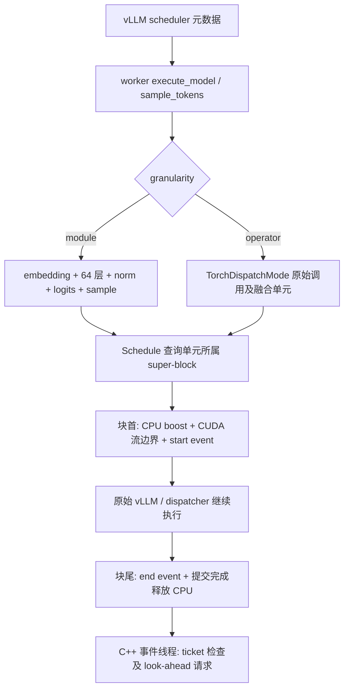

# SparseDVFS v5：Thor / vLLM / Qwen3.5 双粒度参考实现

本包沿用固定 vLLM 0.19.0 镜像、Qwen3.5-27B dense BF16 和单请求 eager 配置，新增 dispatcher 算子路径、profiler 覆盖证据、标定拟合工具与更细的 FUSE 时序记录。v1–v4 文件和压缩包保留不变。

当前机器没有 Thor/CUDA/vLLM 运行环境。交付包括源码、可执行的标准库合成示例和测试；C++/CUDA 编译、真实模型执行、调频和能耗实验均未执行。准确检查结果见 [TEST_RECORD_zh.md](TEST_RECORD_zh.md)。

## 无 GPU 时先看机制

```bash
python3 -B v5_demo.py --output runs/synthetic_v5.json
python3 -B paper_demo.py --scenario dense
python3 -B -m unittest discover -s tests -v
```

v5 示例用人工构造的 CPU/profiler 事件演示“三次请求覆盖 → 算子列表 → super-block → Eq. (1)/(2) 参数拟合”。它还执行恒温导致参数不可辨识的失败案例。所有结果 `synthetic=true, deployable=false`，不分配真实模型张量，也不输出设备节能率。

## super-block 和 FUSE 如何介入

vLLM 仍负责输入准备、混合注意力、KV/Mamba 状态、compute_logits 和采样。worker 子类只在真实执行路径中建立观测作用域，不把 decoder 层取出来重放。



super-block 是频率调度范围，不是替代模型执行的函数。`Schedule.before/after` 只在块首/块尾调用 C++；块内仍执行原有算子。C++ FUSE 指本包独立实现的 Frequency Unified Scaling Engine，不是文件系统 FUSE。

流边界 host function 写 GPC/EMC 约束，它会阻塞后续流工作。普通事件线程根据 start event 的主机观测、块估计时间及切换提前量尝试为下一块发出请求。立即写 sysfs 可能影响当前块，尚不能等同论文未公开的寄存器指令队列。

## 两条路径

- `module` 为默认入口，保留 68 段覆盖与现有五组实验。
- `operator` 记录 ATen/已注册自定义算子，融合算子保持原子单元。先做三次无调频诊断；每个 profile OPP 再做三次独立 profiler 检查，之后才进行关闭 profiler 的正式采样。
- 原生输出不一致、未知上下文/调用顺序、漏归属 GPU 工作或多个 GPU stream 都会使算子路径停止。已验证证书绑定固定输入、模型、镜像和执行签名。
- dispatcher 图是单流串行适配，不能宣称恢复了完整 kernel DAG，也不能证明某融合内核在未来调用内部永不改变 stream。限制详见 [assumptions.md](assumptions.md)。

## 到 Thor 后

完整顺序、命令、通过条件和恢复方法见 [THOR_VLLM_QUICKSTART_zh.md](THOR_VLLM_QUICKSTART_zh.md)。

`python3 -B demo.py` 也指向同一 vLLM 命令入口；旧版本的 Transformers 部署入口仍保留在 v1–v4 包中。

数学核心仍复用 Eq. (1)/(2) 和 Algorithm 1。measured 选择器使用整请求平均功率作为区间能量代理；paper 选择器需要真实、可辨识且通过留出验证的标定。`calibrate collect` 不会把请求平均功率伪造成单算子功率，未知工作量/流量也不会自动填成零。

来源及许可记录见 [SOURCE_MANIFEST.json](SOURCE_MANIFEST.json)、[paper2code/00_reference_search.yaml](paper2code/00_reference_search.yaml)。论文差异表见 [PAPER_ALIGNMENT.md](PAPER_ALIGNMENT.md)，原生时序边界见 [FUSE_PAPER_AUDIT.md](FUSE_PAPER_AUDIT.md)。
